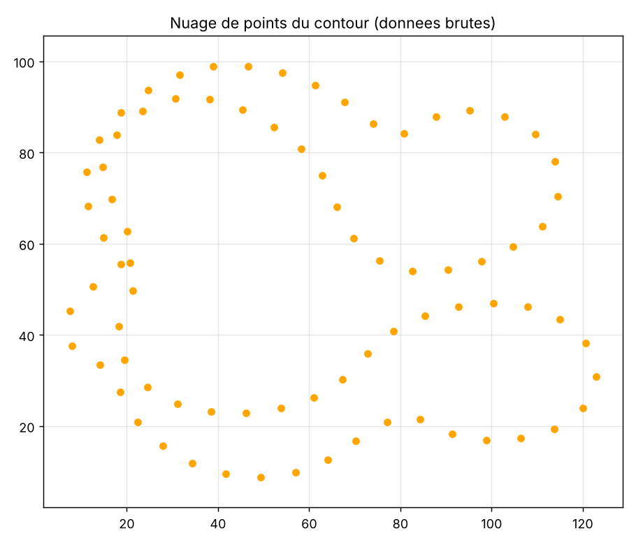
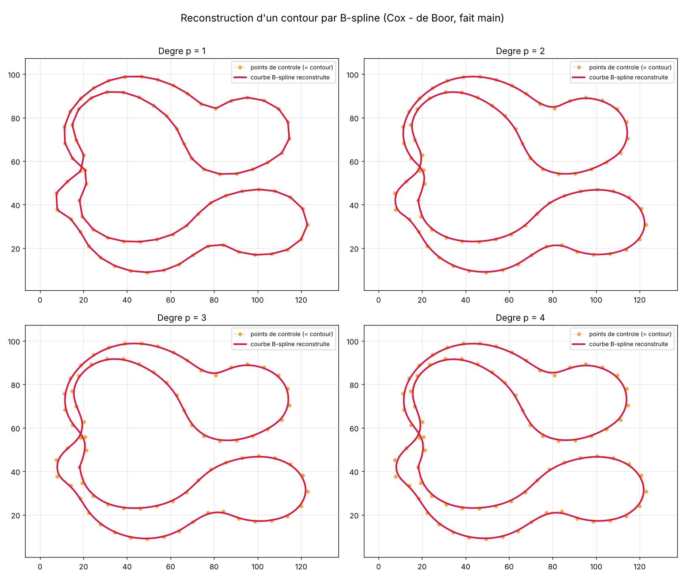

# TP — Reconstruction d'un contour par B-spline

Reconstruction d'un contour (les points d'une pièce) par une courbe **B-spline
programmée à la main**, sans aucune fonction magique (pas de `scipy ... BSpline`,
pas de fonction `bspline` toute faite). Tout tient dans une seule formule : la
**récursion de Cox – de Boor**.

## Lancer le programme

```bash
pip install numpy matplotlib
python3 bspline.py
```

Cela lit `data/points_contour.csv` et enregistre deux images :
`nuage_points.png` (les points bruts) et `resultat_bspline.png` (la
reconstruction pour les degrés p = 1, 2, 3 et 4).

## Les points de départ (nuage de points)



## Le résultat (reconstruction B-spline)



## L'idée en une phrase

Une courbe B-spline est juste une **moyenne pondérée des points de contrôle**.
Les poids changent le long de la courbe : c'est ce qui la rend lisse.

```
          n
 C(t)  =  Σ   N_{i,p}(t) · P_i
         i=0
```

- `P_i` : les points de contrôle (ici = les points du contour).
- `p`   : le degré (1 = lignes droites, plus grand = plus lisse).
- `N_{i,p}(t)` : les poids (« fonctions de base »), calculés par Cox – de Boor.
- `t`   : le paramètre qui parcourt la courbe, de 0 à 1.

## Les 4 briques du code (`bspline.py`)

1. **`lire_points`** — lit le fichier `index,x,y` (gère `,` et `;`).

2. **`vecteur_noeuds`** — construit le *vecteur de nœuds* « clampé » : `p+1`
   zéros au début, `p+1` uns à la fin, le reste réparti régulièrement. Résultat :
   la courbe **part du premier point** et **arrive au dernier**.

3. **`base_bspline`** — **le cœur du TP**. C'est la définition d'une B-spline
   programmée directement :
   - degré 0 : une « marche » qui vaut 1 sur un seul intervalle de nœuds, 0 ailleurs ;
   - degré p : combinaison de deux fonctions de degré `p-1` (formule de Cox – de Boor).
     Un dénominateur nul est ignoré (convention habituelle, évite la division par zéro).

4. **`point_courbe` / `courbe_bspline`** — pour chaque `t`, on fait la somme
   `Σ N_{i,p}(t) · P_i`, et on échantillonne `t` de 0 à 1 pour tracer toute la courbe.

## Ce qu'on observe

- **p = 1** : la courbe = le polygone qui relie les points (aucun lissage).
- **p = 2, 3, 4** : de plus en plus lisse ; la courbe s'éloigne un peu des points
  mais garde la forme globale. C'est le comportement attendu d'une B-spline.

> Contour **fermé** : dans `bspline.py`, on recopie le premier point à la fin
> (`px = np.append(px, px[0])`) pour que la courbe boucle.

## Fichiers

| Fichier | Rôle |
|---|---|
| `bspline.py` | tout le code (lecture, Cox – de Boor, évaluation, affichage) |
| `data/points_contour.csv` | les points du contour (`index,x,y`) |
| `resultat_bspline.png` | la figure produite (degrés 1 à 4) |
